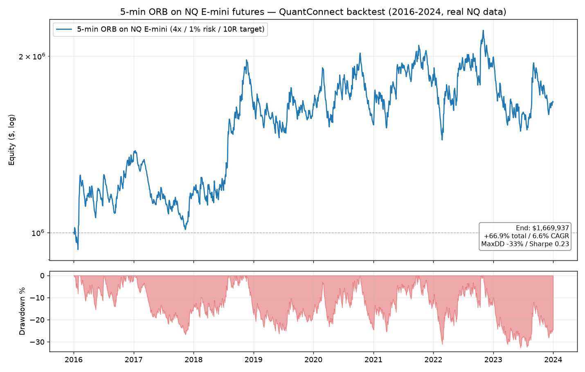
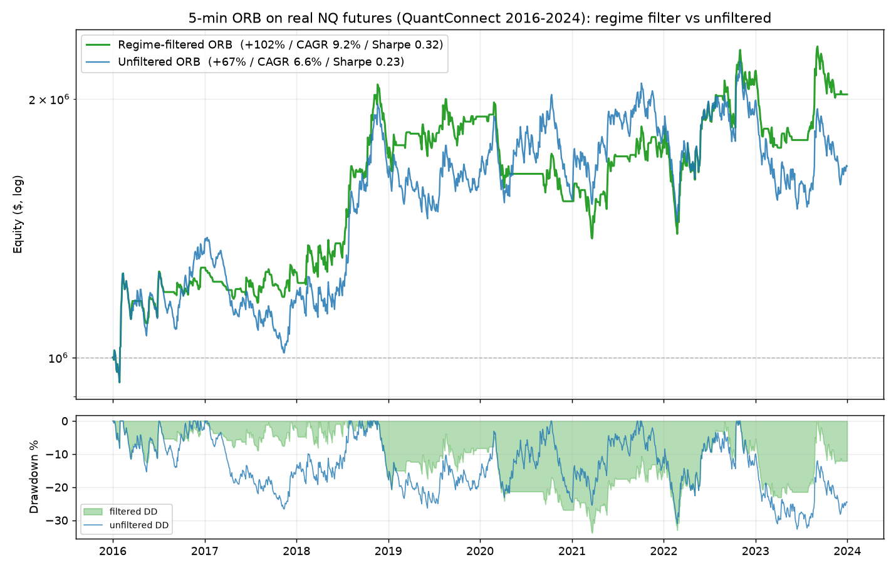
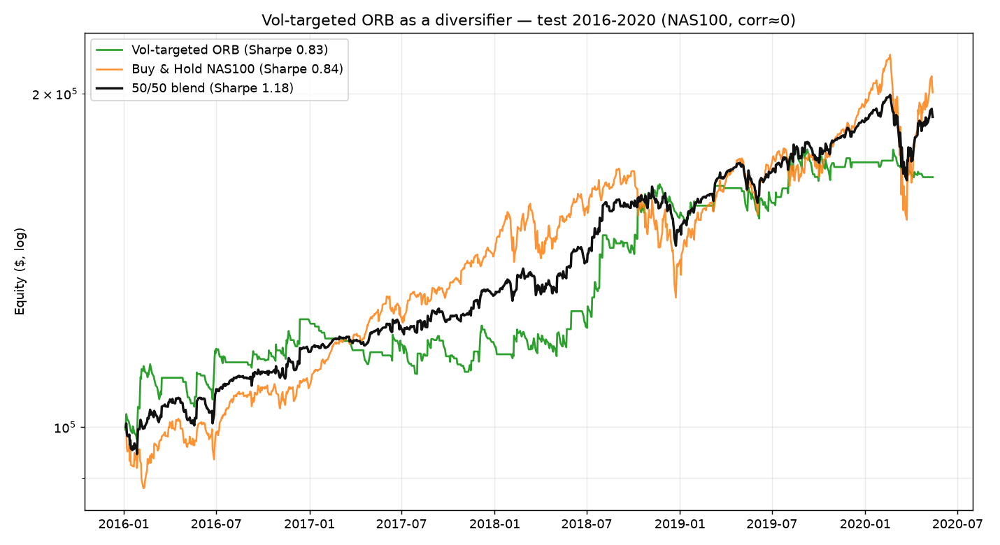
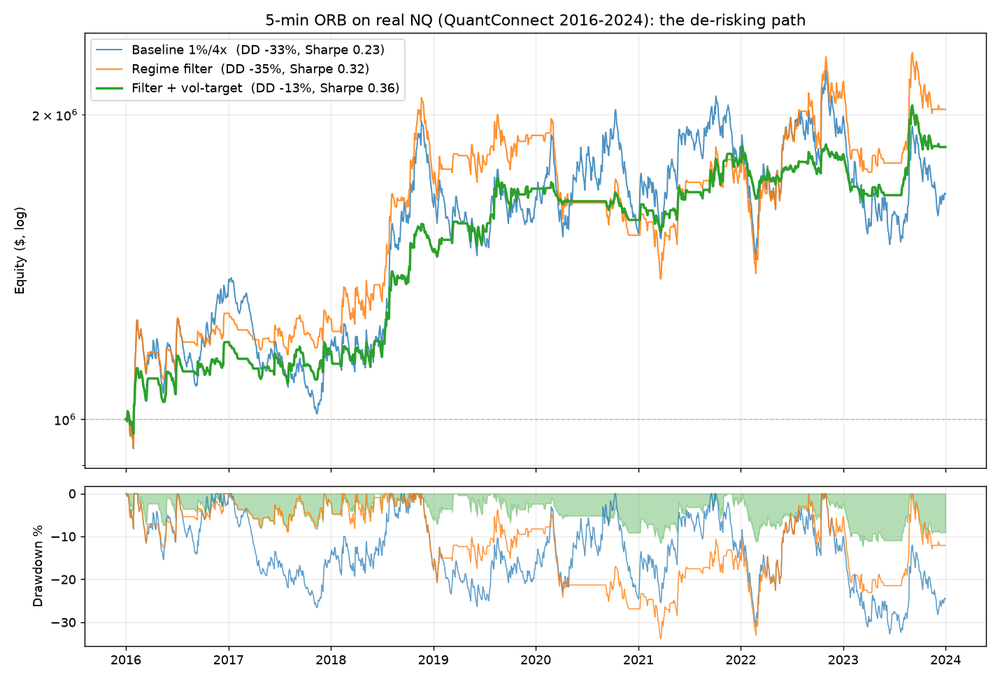
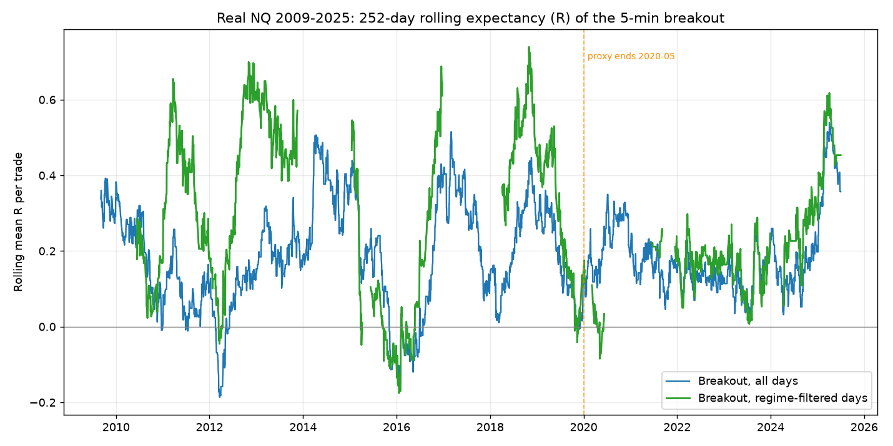
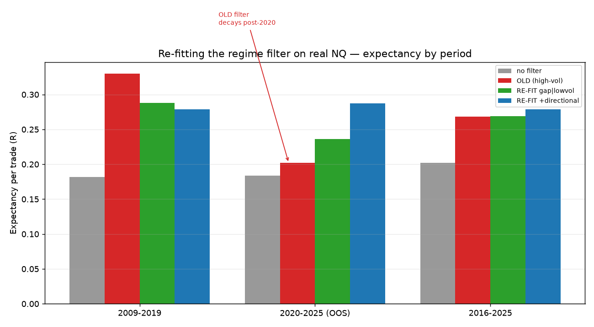

# ORB (Opening Range Breakout) on NQ — strategy replication & backtest

Replication of the **5-minute Opening Range Breakout (ORB)** strategy from

> **Zarattini, C. & Aziz, A. (2023)** — *Can Day Trading Really Be Profitable?
> Evidence of Sustainable Long-term Profits from Opening Range Breakout (ORB)
> Day Trading Strategy vs. Benchmark in the US Stock Market.*
> SSRN **4416622**.

The paper trades **QQQ** with leverage over 2016–2023. Here we take the *same
mechanical rules* and apply them to the **Nasdaq-100 future (NQ)**, then backtest
on **QuantConnect** with real NQ minute data. Full rules: [`strategy/rules.md`](strategy/rules.md).

**TL;DR — the raw 5-min ORB edge on NQ is real but marginal (profit factor ~1.05)
and underperforms holding NQ. A [regime filter](#part-2--regime-switching-does-a-filter-fix-it)
(trade only on high-vol / gap / non-uptrend days) is an out-of-sample-robust
improvement — +102% vs +67%, Sharpe 0.32 vs 0.23, half the trades — but still
trails buy-and-hold and keeps a ~35% leverage drawdown. Promising research base,
not deployable as-is → [Conclusion](#conclusion--go--no-go).**

---

## What was tested

| | Primary (definitive) | Supporting (robustness) |
|---|---|---|
| **Engine** | QuantConnect LEAN (cloud) | Standalone Python (`strategy/orb_backtest.py`) |
| **Instrument** | **NQ E-mini future** — real QC data | OANDA **NAS100** 1-min (NQ proxy) |
| **Window** | 2016-01 → 2024-01 (8y, covers paper) | 2005 → 2020-05 (incl. cost sweep) |
| **Sizing** | 5-min ORB L/S, **1% risk, 4× cap, 10R target** | identical rules |
| **Code** | [`strategy/quantconnect/main.py`](strategy/quantconnect/main.py) | [`strategy/orb_backtest.py`](strategy/orb_backtest.py) |

The two engines implement identical logic and agree closely (win rate ~24%,
profit factor ~1.05), which cross-validates the result.

---

## Primary result — QuantConnect, real NQ futures (2016–2024)

$1,000,000 start · 5-min ORB long+short · 1% risk / 4× leverage cap / 10R target.



| Metric | Value |
|---|---|
| Total return | **+66.9%** (8 years) |
| CAGR | **6.6%** |
| Max drawdown | **−33.2%** |
| Sharpe / Sortino | **0.23** / 1.11 |
| Annualised vol | 24.4% |
| Win rate | 24.0% |
| Avg win / avg loss | +2.76% / −0.81% |
| Profit / loss ratio | 3.41 |
| **Profit factor** | **1.05** |
| Trades | 2,035 (~1 / day) |
| Max consecutive losses | **30** |
| Total fees | $272,224 |

The payoff profile is textbook ORB — **you lose small often (76% of trades,
median hold ~29 min stopped out) and win big rarely (winners run ~6 h to the 10R
target or the close)**. But the aggregate profit factor is only **1.05**.

### Per-year (real NQ)

| Year | 2016 | 2017 | 2018 | 2019 | 2020 | 2021 | 2022 | 2023 |
|---|---|---|---|---|---|---|---|---|
| Return | +37.5% | −13.7% | +36.6% | +2.8% | −8.4% | +19.1% | +9.6% | **−16.2%** |
| Win rate | 25% | 24% | 24% | 23% | 22% | 27% | 24% | 22% |

Notably the strategy **lost 16% in 2023**, a year NQ rallied ~+54% — it does not
capture the very trend it is supposed to exploit.

### Versus buy & hold

| 2016–2023 | Strategy (ORB/NQ) | Buy & hold NQ¹ | Buy & hold SPY² |
|---|---|---|---|
| CAGR | **6.6%** | ~18% | ~14% |
| Total | +67% | ~+280% | +176% |

¹ NQ/QQQ rose roughly +280% over the window. ² SPY = QuantConnect's default
benchmark in the backtest. **Holding the index beat the strategy by ~3× with
comparable drawdown.**

> ⚠️ QuantConnect applied its per-contract fee model but **no explicit slippage**.
> Real ORB entries (09:35 market orders) and stop-outs slip; the proxy sweep below
> shows the edge is destroyed by ~3 bp/side of cost. **The 6.6% CAGR is therefore
> an optimistic upper bound.**

---

## Supporting result — cost sensitivity (NAS100 proxy, standalone engine)

Same rules, Python engine, OANDA NAS100 1-min. The edge is razor-thin and lives
entirely inside the first few basis points of transaction cost:

| Scenario | Window | Cost/side | Expectancy | Profit factor | CAGR | Sharpe | MaxDD |
|---|---|---|---|---|---|---|---|
| Gross | 2016–2020 | 0 bp | +0.216 R | 1.29 | +44.2% | **1.43** | −19% |
| Realistic | 2016–2020 | 1.5 bp | +0.216 R | 1.06 | +8.6% | 0.43 | −36% |
| Higher cost | 2016–2020 | 3 bp | +0.216 R | **0.88** | **−18.2%** | −0.56 | −71% |
| Full history | 2005–2020 | 1.5 bp | +0.109 R | 0.86 | −10.8% | −0.28 | **−90%** |

(Full matrix: [`results/summary_matrix.md`](results/summary_matrix.md),
chart: [`results/equity_curve_2016_2020.png`](results/equity_curve_2016_2020.png).)

Takeaways: (1) a **positive gross edge exists** (Sharpe 1.43 gross), but (2) it is
**consumed by realistic costs**, (3) it is **strongly regime-dependent** (great in
2008/2016/2018, negative in the low-vol grinds of 2017/2010/2012/2015), and (4)
leveraged compounding through the bad stretches produces **~90% drawdowns**.

---

## Why this doesn't match the paper

The paper's headline profits come from things the *plain index ORB does not have*:
1. **Leveraged-ETF compounding** (TQQQ ≈ 3× daily) stacked on the 4× intraday cap,
   in a **specific 2016–2023 equity bull regime**.
2. A later, stronger variant (**SSRN 4729284**) adds a **relative-volume / ATR
   filter and stock selection** — i.e. it trades only a minority of high-quality
   setups, not one index every day.
3. Applied to a single index future with whole-contract sizing and realistic
   futures costs, the raw signal is a ~1.05 profit-factor coin-flip-with-fat-tails.

---

## Part 2 — Regime-switching: does a filter fix it?

Instead of trading the ORB every day, **test several variants, find which regime
each one likes, and only trade when the regime is favourable.** Built on the
daily panel in [`strategy/regime_research.py`](strategy/regime_research.py) (8 ORB
variants × ex-ante regime features), with a strict **train (2005–2015) / test
(2016–2020)** split to avoid curve-fitting.

**What the regimes say** (patterns consistent on *both* train and test):

| Feature (ex-ante) | Breakout works when… | …and fails when |
|---|---|---|
| Realised vol (20d) | **high** vol | low vol |
| Trend (50d) | flat / **down** trend | strong uptrend |
| Opening gap | **large** \|gap\| | flat open |
| Fade (mean-revert) | **never** — negative in every regime | — |

So the useful switch is not breakout-vs-fade, it is **breakout-ON vs stand-aside**.
Filter (thresholds frozen on train): trade the 5-min breakout only when
`rvol20 > 0.156` **or** `|gap| > 0.30%`, **and** `trend50 ≤ 4.1%`.

**Proxy result, net of 1.5 bp/side** ([`results/regime_strategy_results.json`](results/regime_strategy_results.json)):

| | Expectancy | CAGR | Sharpe | MaxDD |
|---|---|---|---|---|
| Unfiltered, full 2005–2020 | +0.11 R | **−10.8%** | −0.28 | −90% |
| **Filtered**, full 2005–2020 | **+0.25 R** | **+4.5%** | 0.30 | −43% |
| Unfiltered, test 2016–2020 | +0.22 R | +8.6% | 0.43 | −36% |
| **Filtered**, test 2016–2020 | **+0.35 R** | **+12.8%** | 0.63 | −24% |

The filter **flips the losing full-history run positive, roughly doubles per-trade
expectancy and halves drawdown — out-of-sample.**

### Confirmed on real NQ (QuantConnect, 2016–2024; 2020–24 is out-of-sample)



| Metric | Unfiltered | **Regime-filtered** |
|---|---|---|
| Total return | +66.9% | **+102.4%** |
| CAGR | 6.6% | **9.2%** |
| Sharpe / Sortino | 0.23 / 1.11 | **0.32 / 1.36** |
| Annual vol | 24.4% | **20.0%** |
| Profit factor | 1.05 | **1.10** |
| Max drawdown | −33% | −35% *(not improved)* |
| Max consecutive losses | 30 | **19** |
| Trades / fees | 2,035 / $272k | **1,084 / $143k** |

Per-year (real NQ, filtered): the filter cut the bad years hard — **2017 −1%**
(was −14%), **2019 +12%** (was +3%), **2022 +23%** (was +10% — a high-vol
downtrend, the filter's sweet spot), **2023 −6%** (was −16%). The one year it made
*worse* was **2020 (−20% vs −8%)**: the COVID crash + V-recovery is a high-vol
whipsaw that trips the filter ON into 4× leveraged chop — which is exactly why the
max drawdown does **not** improve.

---

## Part 3 — De-risking: volatility targeting & diversification

The filtered edge is positive, so the last problem is the 35% leverage drawdown.
[`strategy/sizing_research.py`](strategy/sizing_research.py) tests alternative
sizings on the filtered strategy and — crucially — the strategy's value **as an
overlay** (its market beta is ~0.09, correlation to NAS100 ≈ **0**).

**Volatility targeting** — `risk_t = clip(0.001 / rvol20, 0.2%, 1.2%)`, i.e. risk
*less* when realised vol is high (exactly the 2020 whipsaw) — dominates the flat 4×
sizing (proxy, test 2016–2020):

| Sizing (filtered) | CAGR | Vol | Sharpe | MaxDD | Calmar |
|---|---|---|---|---|---|
| 1% risk / 4× (base) | 12.8% | 23% | 0.63 | −24% | 0.52 |
| **Vol-targeted** | 12.7% | 16% | **0.83** | **−11%** | **1.18** |
| Buy & Hold NAS100 | 17.2% | 21% | 0.84 | −29% | 0.59 |

Same return, **half the drawdown**, Sharpe now matches buy & hold and Calmar
doubles it.

**As a diversifier it is stronger still.** A 50/50 daily-rebalanced blend of buy &
hold NAS100 + vol-targeted ORB (correlation ≈ 0):

| | CAGR | Sharpe | MaxDD |
|---|---|---|---|
| Buy & Hold NAS100 (test 2016–2020) | 17.2% | 0.84 | −29% |
| **50/50 blend (test)** | 15.6% | **1.18** | **−16%** |
| Buy & Hold NAS100 (full 2005–2020) | 11.9% | 0.63 | −54% |
| **50/50 blend (full)** | 8.0% | **0.66** | **−27%** |



The blend **beats buy & hold on risk-adjusted return in both periods** (Sharpe
1.18 vs 0.84; 0.66 vs 0.63) with **roughly half the drawdown**, because the ORB
overlay is uncorrelated. Standalone on the full 15 years the strategy still trails
(Sharpe 0.26) — its role is a low-correlation *overlay*, not a replacement.

### Vol-targeting confirmed on real NQ (QuantConnect 2016–2024)

The proxy result reproduces on real NQ futures (QC project 34427985):



| Metric (real NQ) | Baseline 1%/4× | Regime filter | **Filter + vol-target** |
|---|---|---|---|
| CAGR | 6.6% | 9.2% | 8.0% |
| **Max drawdown** | −33% | −35% | **−13%** |
| Annual vol | 24% | 20% | **11.9%** |
| Sharpe | 0.23 | 0.32 | **0.36** |
| **Calmar** | 0.20 | 0.26 | **0.62** |
| Total fees | $272k | $143k | **$87k** |

Vol-targeting **cut the drawdown from 35% to 13%** for a small give-up in CAGR — its
Calmar (0.62) now **beats buy-and-hold NQ's ~0.49**. The 2020 whipsaw went from
−20% to **−6.9%**, exactly where the sizing pulls risk down.

---

## Part 4 — Extended to real NQ 2009–2025

The OANDA proxy ends 2020-05. To extend past it, the 8-variant panel + regime
features were recomputed on **real NQ minute data 2009–2025** inside QuantConnect
([`strategy/quantconnect/panel_exporter.py`](strategy/quantconnect/panel_exporter.py))
and exfiltrated via order tags (free tier blocks ObjectStore/log export), giving
[`results/nq_panel_real.csv`](results/nq_panel_real.csv) — 4,252 trading days.

**The base edge persists and is *stronger* on real NQ** (expectancy in R, full sample):

| Variant | Proxy 2005–2020 | **Real NQ 2009–2025** |
|---|---|---|
| brk5_10R (breakout) | +0.109 | **+0.188** |
| brk5_short | +0.117 | **+0.193** |
| fade5_eod (fade) | −0.283 | −0.024 *(still ≤ 0)* |

**But the regime filter's edge decayed after 2020** — the honest payoff of extending
the data:

| Filter uplift (brk5_10R expectancy) | all days | filtered days |
|---|---|---|
| 2009–2019 | +0.182 R | **+0.330 R** |
| **2020–2025 (out-of-sample)** | +0.184 R | **+0.202 R** |



Pre-2020 the filter nearly doubled expectancy; post-2020 it barely helps — the
**high-volatility relationship inverted** (2020–2025 the breakout was actually best
in *low* vol), while the **gap signal held** (gap-up still the best regime). The raw
breakout stayed positive everywhere, so filtering mostly just halves trade count
(and cost) now rather than lifting the edge.

*Takeaway: rely on the persistent base breakout + vol-targeting (both confirmed on
real NQ through 2025); treat the high-vol filter threshold as stale and re-fit it
(the gap component is the durable part).*

### Re-fitted filter ([`strategy/refit_filter.py`](strategy/refit_filter.py))

Re-fitting on real NQ (thresholds on 2009-2019, validated on 2020-2025) confirms the
durable signal is **gap size**, with a **low-vol** leg (the post-2020 pattern) and a
**directional tilt** (short-only breakout on gap-down days, where shorts made +0.40 R
vs +0.21 R in 2020-2025). Expectancy per trade (R) / R-Sharpe by period:

| Signal | 2009-2019 | 2020-2025 (OOS) | 2016-2025 |
|---|---|---|---|
| no filter (base) | +0.182 / 1.07 | +0.184 / 1.14 | +0.202 / 1.23 |
| OLD filter (high-vol) | +0.330 / 1.34 | +0.202 / **0.92** | +0.268 / 1.15 |
| **RE-FIT `gap OR low-vol`** | +0.288 / **1.38** | +0.236 / **1.18** | +0.269 / **1.35** |
| **RE-FIT + directional** | +0.279 / 1.23 | **+0.287** / 1.22 | +0.279 / 1.23 |



The OLD filter's R-Sharpe fell **below no-filter** out-of-sample (0.92 < 1.14) — it
was actively hurting. The **re-fit `gap OR low-vol`** restores a robust uplift in
*every* period (R-Sharpe 1.18-1.38); adding the directional tilt gives the highest
per-trade expectancy out-of-sample (+0.287 R, trading ~half the days). Definition in
[`results/refit_filter.json`](results/refit_filter.json):
`trade if |gap| > 0.33% OR rvol20 < 0.122; on gap-down days, short-only`.

---

## Conclusion — go / no-go

1. **Plain 5-min ORB on NQ — no-go.** Profit factor ≈ 1.05, Sharpe ≈ 0.23, −33%
   drawdown, up to 30 consecutive losers (before slippage, which flips it negative
   near 3 bp/side). Underperforms buy-and-hold NQ ~3× and lost money in 2023.
2. **Regime filter — the original decayed post-2020, but a re-fit repairs it.** The
   high-vol filter fell below no-filter out-of-sample (R-Sharpe 0.92 < 1.14). The
   **re-fit `gap OR low-vol` (+ short-on-gap-down) filter** restores a robust uplift
   in every period (R-Sharpe 1.18-1.38, expectancy +0.24-0.29 R) while trading
   ~half-to-two-thirds of days — the durable, deployable filter.
3. **Vol-targeting + use as an overlay — this is the deployable form.** It cuts the
   drawdown to ~11% at unchanged return (proxy), and a 50/50 blend with buy-and-hold
   NQ **beats buy-and-hold's Sharpe with half the drawdown**. The edge is genuine
   but modest and *diversifying*, not a standalone index-beater.

**Verdict: worth pursuing — as a vol-targeted, regime-filtered intraday *overlay* on
an NQ book, not as a standalone system.**

**Remaining before capital:**
1. **Model slippage explicitly** — every QC run excludes it; verify the edge
   survives ~1 tick/side on entries and stops (the single biggest open risk).
2. **Confirm the re-fit `gap OR low-vol` filter at contract level on QC** (signal-
   level uplift is already validated on the real-NQ panel; verify net equity/DD).
3. **Paper-trade the live vol-targeted overlay** before sizing up.
3. **Exit research** — 10R fires on only ~2–5% of trades; test trailing stops /
   partial take-profit.
4. **MNQ** for retail-size granularity.

---

## Reproduce

```bash
# 1. Standalone proxy backtests (data auto-clonable; see data/README.md)
python3 strategy/orb_backtest.py --data-dir <NAS100_dir> --start-year 2016 --end-year 2020 --out results/orb
python3 strategy/run_matrix.py   --data-dir <NAS100_dir> --out-dir results   # cost sweep
python3 strategy/regime_research.py --data-dir <NAS100_dir> --out results/daily_panel.csv
python3 strategy/regime_strategy.py --data-dir <NAS100_dir> --out-dir results  # filtered vs baseline

# 2. QuantConnect (real NQ): open the algorithm in a QC project and Backtest.
#    Ready projects exist in the connected account:
#      strategy/quantconnect/main.py         -> project 34424955  (unfiltered)
#      strategy/quantconnect/main_regime.py  -> project 34426838  (regime-filtered)
```

Artifacts: [`results/`](results/) — QC statistics & equity JSON, proxy matrix,
charts. Extracted rules: [`strategy/rules.md`](strategy/rules.md).

*Backtests are historical simulations, not investment advice. The QC run excludes
slippage and is an optimistic bound.*
