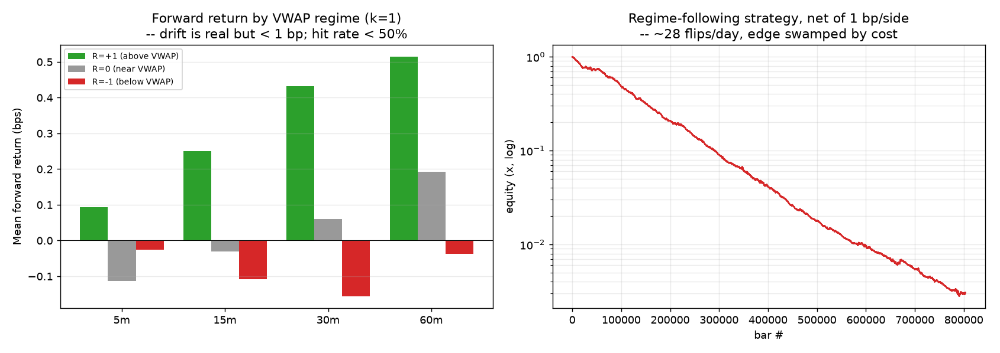

# VWAP-Based Regime Classification (Lee, 2026) — review & empirical test

Paper: **Lee, Chong Yul (2026), "VWAP-Based Regime Classification Model for
Intraday Price Dynamics", SSRN 6438039** (PDF committed at repo root as
`6438039.pdf`).

## What the paper actually contains

The paper defines exactly one thing — a **3-state classifier**:

```
p_t = (P_t − VWAP_t) / σ_t                 # volatility-standardised deviation
R_t = +1  if p_t >  k     (bullish trend)
      −1  if p_t < −k     (bearish trend)
       0  if |p_t| ≤ k    (neutral / mean-reverting)
```

`P_t` = price, `VWAP_t` = volume-weighted average price, `σ_t` = a volatility
measure, `k > 0` = threshold. That is the whole model.

**What it does NOT contain (verified by reading all 24 pages):**
- ❌ No trading rules — no entry, exit, stop, target, or sizing.
- ❌ No backtest, no data, no performance numbers, no equity curve.
- ❌ No committed choice of `σ_t`, `k`, VWAP window, instrument, or timeframe
  (all are left as "tuning" / "extensions" / "future research").
- The author explicitly lists *"empirically testing the model across assets and
  time periods"* under **Directions for Future Research**, and recommends pairing
  it with other tools (volume profile, VWAP±1σ bands, Bookmap/DOM).

In short it is a **conceptual note** that formalises the universally-known "price
above/below VWAP = bullish/bearish, scaled by volatility" heuristic — i.e. a
**VWAP z-score / VWAP-bands** indicator, which every charting platform already
ships. It is *not* a strategy and makes *no* profitability claim.

## The empirical test the paper is missing

`vwap_regime_test.py` implements `p_t`/`R_t` faithfully (session VWAP on typical
price, `σ_t` = rolling 20-bar stdev) and tests it on NAS100 (NQ proxy) 1-min data
with tick volume, 2012–2020 (≈773k bars, 2154 days).

**1) Does the regime predict forward returns?** Mean forward return by regime (bps):

| Horizon | R=+1 (above) | R=0 (near) | R=−1 (below) | continuation hit-rate |
|---|---|---|---|---|
| 5 min  | +0.08 | −0.09 | −0.01 | 48.1% |
| 15 min | +0.25 | −0.03 | −0.11 | 48.9% |
| 30 min | +0.43 | +0.06 | −0.16 | 47.4% |
| 60 min | +0.51 | +0.19 | −0.04 | 43.5% |

The drift is *directionally* consistent with the paper (above VWAP → mild positive
drift), but it is **< 1 bp** and the **continuation hit-rate is below 50%** — the
positive mean comes from asymmetry, not from being right often, and it partly just
re-captures the 2012–2020 market up-drift (price sits above VWAP more in uptrends).

**2) As a standalone strategy** (position = R_t, hold to regime change):

| k | flips/day | gross bps/trade | net total, 1 bp/side | net total, 2 bp/side |
|---|---|---|---|---|
| 1.0 | 28.7 | 0.07 | **−573%** | **−1192%** |
| 1.5 | 27.5 | 0.09 | −539% | −1132% |
| 2.0 | 25.1 | 0.10 | −485% | −1026% |

The regime flips ~28×/day; the ~0.08 bps gross edge per trade is **~20× smaller
than one round-trip cost**, so net performance is catastrophic.



## Verdict

**Not worth trading as presented.** Unlike the Zarattini ORB paper (explicit rules
+ reported, verifiable performance), this paper has no strategy and no evidence,
and the naive implementation of its classifier has no tradeable edge — the tiny
VWAP-z drift is destroyed by costs. It is a tidy formalisation of a standard
indicator, useful pedagogically, not a source of alpha.

**Where it could still help (honestly):** `R_t` is a clean, cheap *context filter*.
It is plausibly useful not as a signal but to *condition* another strategy — e.g.
only take ORB longs when `R_t = +1`, fade only when `R_t = 0`. That is a legitimate
follow-up (and mirrors what actually worked for the ORB regime filter), but it is
**our** addition, not the paper's.
